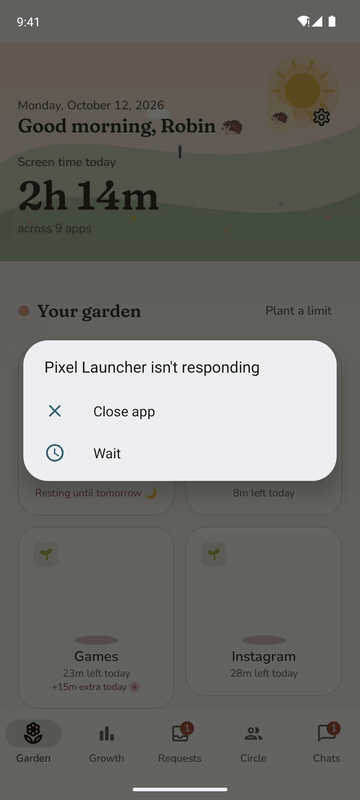
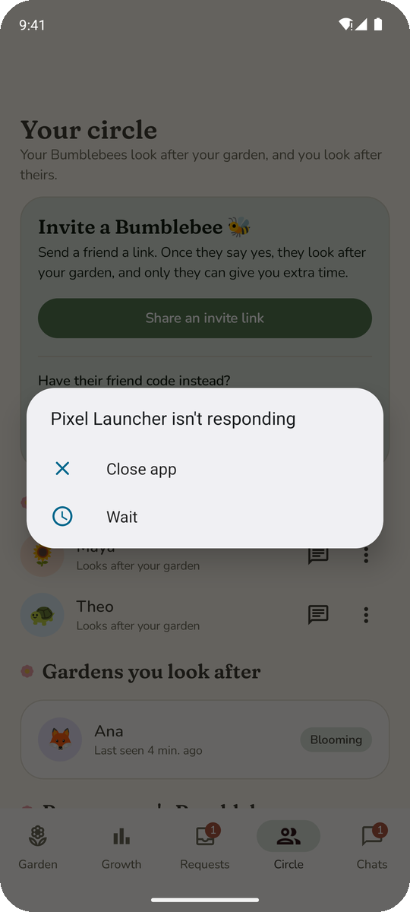
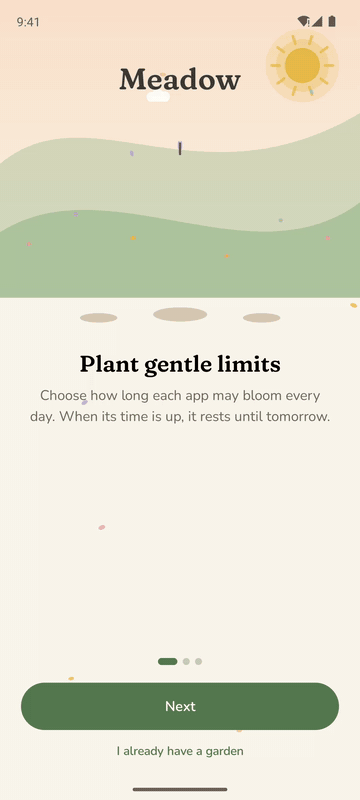

<picture>
  <source media="(prefers-color-scheme: dark)" srcset="docs/images/banner-dark.svg">
  
</picture>

<p align="center">
  <a href="https://github.com/PCOffline/meadow/actions/workflows/build.yml"></a>
  <a href="LICENSE"></a>
  
</p>

**Meadow is a cozy way to spend less time on the apps that pull you in.** Give each app a little
patch of time. When it's used up, the app rests until tomorrow. Want more? Ask one of your
**Bumblebees**, the friends you've chosen to look after your garden. Willpower is hard; a kind
friend who has to say yes is much harder to argue with.

<p align="center">
  
  &nbsp;
  
  &nbsp;
  
</p>

## How it works

<table>
  <tr>
    <td align="center" width="33%"><br><b>Plant a limit</b><br>Choose how long an app may bloom each day or week.</td>
    <td align="center" width="33%"><br><b>It rests</b><br>When the time is used up, the app closes gently until tomorrow.</td>
    <td align="center" width="33%"><br><b>Ask a Bumblebee</b><br>Need more? A friend can say yes, right from their notification.</td>
  </tr>
</table>

## Features

### A garden that grows with your time
Every app you limit is a flower that blooms while there's time left and wilts as it runs out. The
sky follows your day, from a peach sunrise to a starry night with fireflies. Gentle reminders
arrive at five minutes and one minute left.

### Friends who have your back
Invite a friend with a link and they become your Bumblebee. Only a Bumblebee can give you extra
time, loosen a limit or remove one. Making a limit stricter is always up to you. Each Bumblebee
gets a chat with you, and your requests appear in it as cards they can answer with one tap.

<p align="center">
  
  &nbsp;
  
</p>

### Hard to wriggle out of
Strict mode keeps Meadow's own settings, uninstalling and the phone's clock out of reach, and
turning it off needs a Bumblebee's yes too. If something gets switched off anyway, or your phone
goes quiet, your Bumblebees are told. Your limits keep working offline.

### For real emergencies
Lost and need maps? Unlock everything for up to an hour, a few times a month, with a short note
for your Bumblebees. Calls and emergency apps are never limited.

### See your days take shape
Daily, weekly and monthly views show where your time went, how it compares with the week before,
and which days were the calmest.

### Make it yours
Six themes, each by day or by night: Meadow, Cherry blossom, Lavender field, Sunflower, Lily pond
and Mushroom forest. Pick a critter or flower for your picture, or use a photo, and add a few
words about yourself.

<p align="center">
  
</p>

### Private by default
No email needed to start; later you can keep your garden safe with Google, a sign-in link emailed
to you, or a password. You choose whether your Bumblebees see today's screen time. Your
detailed history never leaves your phone. Who looks after whom is your own business: only the
person affected is told when you add or remove a Bumblebee. Download everything Meadow holds about
you, or delete your account, any time. Read the [privacy notice](legal/privacy_notice.md).

### Kind to everyone
Built for TalkBack, large text and switch access: every control is labelled, touch targets are
large, and every theme meets WCAG AA contrast. All motion stops when you turn animations off.

<p align="center">
  
</p>

---

## Get Meadow

Download the latest APK from [Releases](https://github.com/PCOffline/meadow/releases) and
open it on your phone (you may need to allow installing from your browser or files app). Meadow
checks for new releases once a day on Wi-Fi and asks before updating; you can turn this off in
Settings.

On first launch, Meadow asks for **usage access** (to measure time) and for its **garden keeper**
accessibility service (to rest apps whose time is up). On Android 13 and newer, sideloaded apps
need *App info → ⋮ → Allow restricted settings* before the garden keeper can be turned on.

Meadow needs a backend to run. The releases here are built for this project's own Firebase
project; to run your own copy, follow the steps below.

## Run your own Meadow

Meadow runs on [Firebase](https://firebase.google.com). A group of friends fits comfortably in the
free allowances, but Cloud Functions require the pay-as-you-go **Blaze** plan, so you'll need a
billing account. Expect $0 a month, or a few cents for stored function images.

### 1. Create the Firebase project
1. Go to <https://console.firebase.google.com> and choose **Create a project**. Give it a name.
   Google Analytics isn't needed; you can turn it off.
2. In the left menu open **⚙ → Usage and billing → Details & settings** and switch to the
   **Blaze** plan. Then, in Google Cloud's **Billing → Budgets & alerts**, add a small budget
   (for example $1) so you hear about any surprise.
3. **Build → Authentication → Get started.** Under *Sign-in method*, add these providers:
   - **Email/Password**, and inside it also turn on **Email link (passwordless sign-in)**.
   - **Google**: choose a support email address, then save.
   - **Anonymous**, so people can start without an account.

   Under *Settings → Authorized domains*, check that `<project-id>.web.app` is listed (it is by
   default). Sign-in links are delivered through it.
4. **Build → Firestore Database → Create database.** Pick a location close to your friends (it
   can't be changed later) and start in **production mode**.
5. **Build → Storage → Get started.** Production mode, same location.

### 2. Connect the Android app
1. In **⚙ Project settings → General → Your apps**, choose the **Android** icon.
2. Package name: `dev.pcoffline.meadow`. Add your signing certificates' **SHA-1** fingerprints:
   run `./gradlew signingReport` and add the SHA-1 of every key you build with (debug for
   testing, your release key for releases). **Sign in with Google only works for keys listed
   here.** You can add more later under *Your apps → Add fingerprint*.
3. Download **google-services.json** and put it in the `app/` folder. Download it again whenever
   you add a fingerprint or enable Google sign-in: it carries the OAuth client that Google
   sign-in needs.
4. The console then shows how to add the Google services Gradle plugin and the Firebase BoM.
   Meadow already has both (see `gradle/libs.versions.toml`), so choose **Next** through those
   steps. It deliberately leaves out `firebase-analytics`: Meadow doesn't collect analytics.

**Is google-services.json secret?** No. It holds identifiers (project ID, app ID, an API key that
only says which project to talk to), and it ships inside every APK anyway. What protects your
data are the Firestore and Storage security rules in `backend/`, which are deployed in step 3.
This repository still keeps the file out of git (it's in `.gitignore`), because every copy of
Meadow should use its own project and a public key invites quota abuse. To make the key useless
outside your app, in Google Cloud open **APIs & Services → Credentials**, edit the key named
*Android key (auto created by Firebase)*, and under *Application restrictions* choose
**Android apps** and add `dev.pcoffline.meadow` with your SHA-1 fingerprints.

### 3. Deploy the backend
```bash
npm install -g firebase-tools
firebase login
cd backend
firebase use --add                # pick your project; call it "default"
npm ci && npm --prefix functions ci
firebase deploy --only firestore,functions,storage,hosting
```
The first deploy turns on the Cloud APIs it needs, which can take a few minutes. If it asks about
a cleanup policy for function images, say yes.

### 4. Make invite and sign-in links open the app
Invite links (`https://<project-id>.web.app/i/…`) and passwordless sign-in links
(`https://<project-id>.web.app/__/auth/links…`) open straight in Meadow once Android trusts your
domain. Put your signing keys' **SHA-256** fingerprints (from `./gradlew signingReport`) into
`backend/hosting/.well-known/assetlinks.json` and deploy hosting again. Without it, invite links
still work through the web page's *Open in Meadow* button, but sign-in links open in the browser.

### 5. Build
```bash
./gradlew assembleDebug           # app/build/outputs/apk/debug/app-debug.apk
```
Without `google-services.json` the app builds, but opens on a "connect your backend" screen.

To build in GitHub Actions, add the file's contents as a repository secret named
`GOOGLE_SERVICES_JSON` (**Settings → Secrets and variables → Actions → New repository secret**).

### Publishing releases
Push a tag like `v1.2.0` and the Release workflow tests, builds and signs the APK and publishes it
on the Releases page; installed copies offer the update within a day. It needs these secrets:

| Secret | What to put in it |
|---|---|
| `GOOGLE_SERVICES_JSON` | The contents of `google-services.json` |
| `MEADOW_KEYSTORE_BASE64` | Your release keystore, as `base64 -w0 release.jks` |
| `MEADOW_KEYSTORE_PASSWORD`, `MEADOW_KEY_ALIAS`, `MEADOW_KEY_PASSWORD` | The keystore's password, key alias and key password |

Sign every release with the same key, or installed copies can't update. Keep the keystore
somewhere safe. If you publish on Google Play instead, updates come from Play.

## How Meadow keeps its promises

- Limits are enforced on the phone, from a copy that works offline and signed out.
- An accessibility service notices which app is on screen and closes it when its time is up; a
  background service double-checks the usage log.
- Loosening a limit, extra time and Bumblebee changes go through the backend, whose security
  rules only let a phone make things stricter on its own.
- Nothing on Android can stop a phone's owner who is determined (safe mode, a factory reset,
  developer tools). Meadow makes getting around it deliberate and visible, because your
  Bumblebees are told.

## Tests

| What | Command |
|---|---|
| App unit, screen and accessibility tests | `./gradlew testDebugUnitTest` |
| Lint | `./gradlew lintDebug` |
| Cloud Functions unit tests | `cd backend/functions && npm test` |
| Security rules (Firestore and Storage) | `cd backend && npm ci && npm run test:rules` |
| Cloud Functions on the emulators | `cd backend && npm ci && npm --prefix functions ci && npm run test:integration` |
| Hosted legal pages | `cd backend && npm run test:hosting` |
| End to end, on an Android emulator | Start the Firebase emulators (`npx firebase emulators:start --only auth,firestore,functions,storage --project demo-meadow` in `backend/`), then `./gradlew connectedDebugAndroidTest -Pmeadow.emulatorHost=10.0.2.2` |

The emulator-based tests need Java 21. CI runs everything on every push.

## Contributing

Issues and pull requests are welcome. See [CONTRIBUTING.md](CONTRIBUTING.md) for the voice guide,
accessibility checks and how the README images are made.

## Licence and credits

Meadow is free software under the [GNU GPL v3](LICENSE). See the [terms of use](legal/terms_of_use.md)
and [open-source licences](legal/licenses.md). Fonts: [Fraunces](https://github.com/undercasetype/Fraunces)
and [Nunito](https://github.com/googlefonts/nunito) (SIL Open Font License).
