<picture>
  <source media="(prefers-color-scheme: dark)" srcset="docs/images/banner-dark.svg">
  
</picture>

  
  
  

Meadow helps you spend less time on the apps that pull you in. Each app gets a set amount of
time. When the time is used, the app rests. To get more time, ask a Bumblebee: a friend you
chose to look after your garden.

  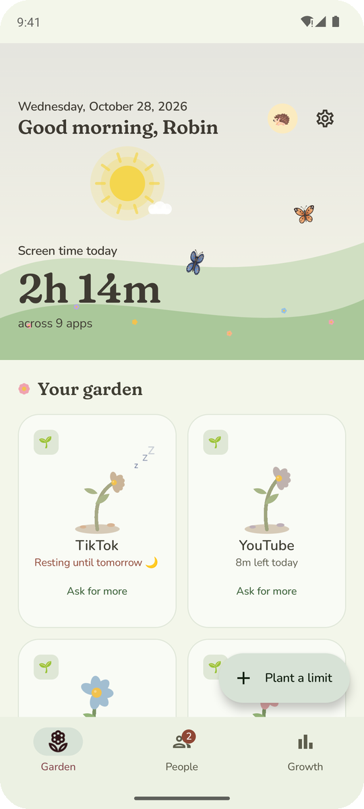
  &nbsp;
  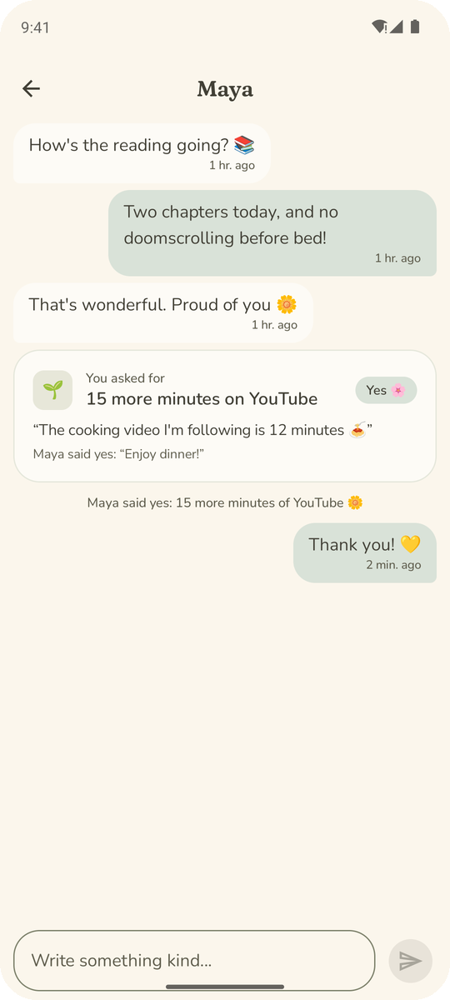
  &nbsp;
  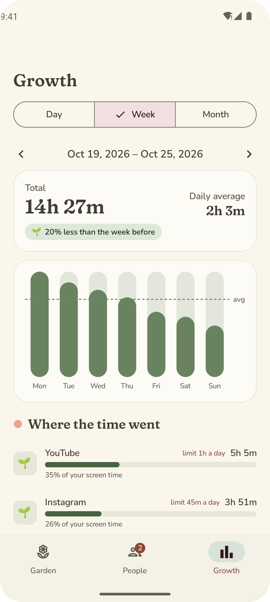

## How it works

<table>
  <tr>
    <td align="center" width="33%"> <b>Plant a limit</b> Choose how long an app can open each day or week.</td>
    <td align="center" width="33%"> <b>It rests</b> When the time is used, the app closes until tomorrow.</td>
    <td align="center" width="33%"> <b>Ask a Bumblebee</b> A friend can give you more time with one tap.</td>
  </tr>
</table>

## Your garden

Each app you limit is a flower. The flower is open while time is left and closes as the time
goes. The sky follows your day, from sunrise to a night with fireflies. It can also show the
weather outside.

## Limits for your week

Give each app a daily limit, a weekly limit, or both. Give some days more time, for example
the weekend. Choose the hours an app can open. Limit websites the same way.

  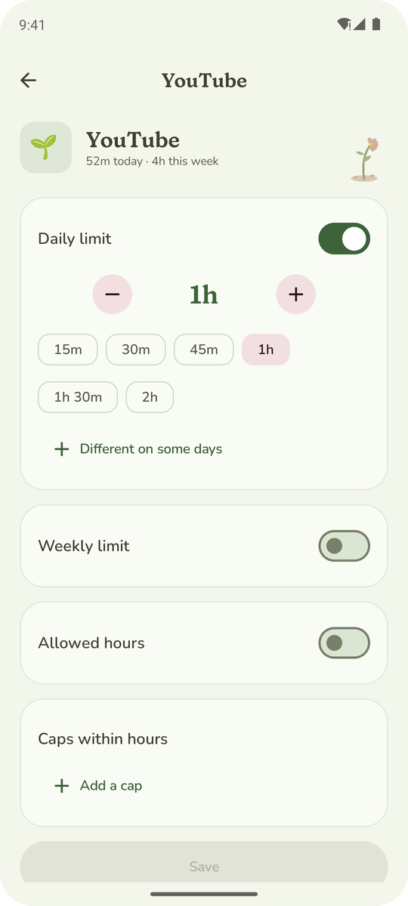

## When time is up

You get a reminder at 15, 10, 5, 2 and 1 minutes, and at 30 seconds. Then the app rests until
tomorrow. Go do something else, or ask a Bumblebee for more time.

In a real emergency, unlock all your apps for up to one hour. You can do this three times in
30 days. Calls and emergency apps never rest.

  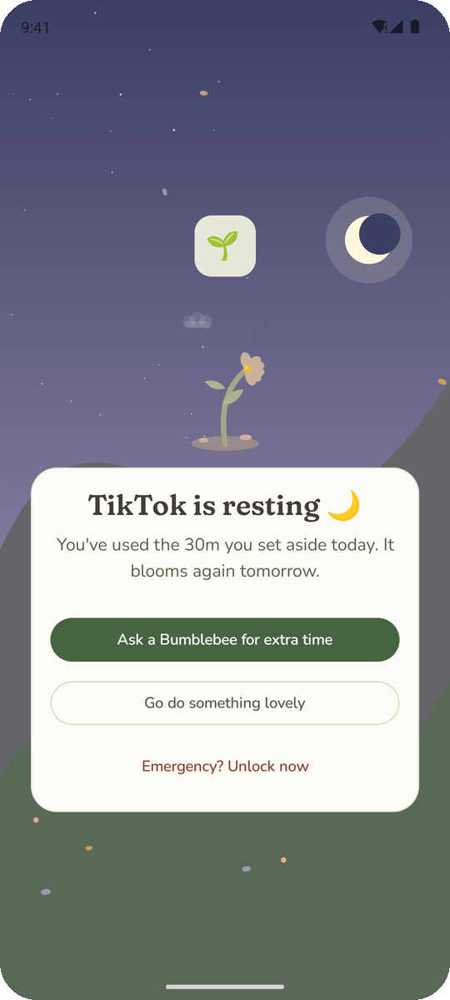
  &nbsp;
  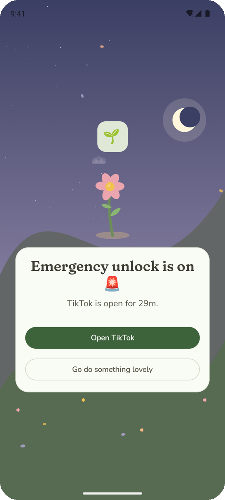

## Friends who help

Invite a friend to be your Bumblebee. Only a Bumblebee can give you more time or make a limit
easier. You can always make a limit stricter yourself. Your requests go to your chat with them,
and they answer with one tap. Send messages, photos and GIFs. Look after a friend's garden too.

  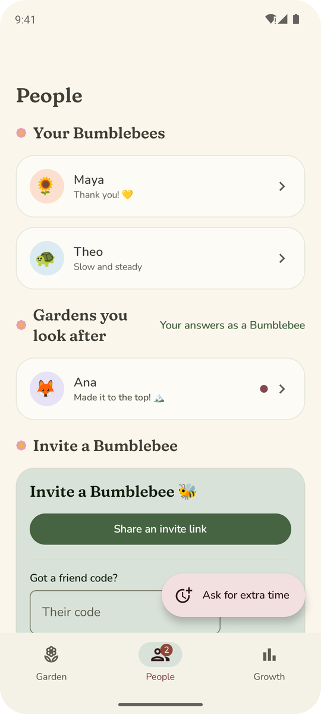
  &nbsp;
  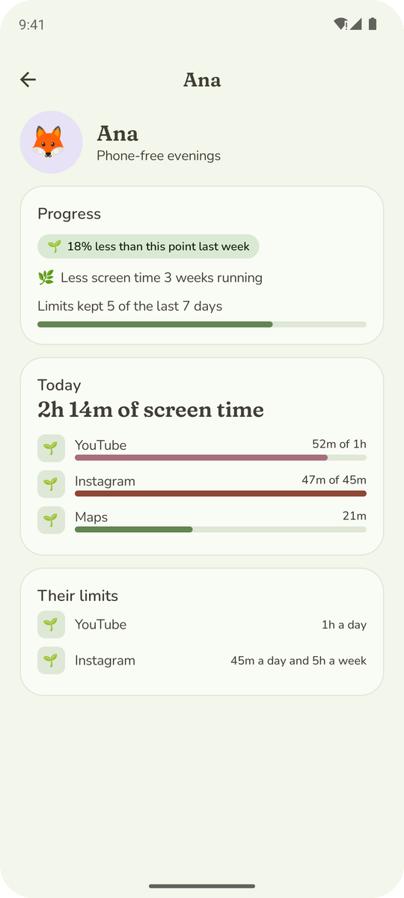

## Strict mode

Strict mode stops changes to Meadow's settings and the phone's clock. It also stops anyone
from removing Meadow. To turn strict mode off, a Bumblebee must agree. If Meadow stops working,
your Bumblebees get a message.

## Private by default

You choose what your Bumblebees see. Your full history stays on your phone. Download all your
data, or delete your account, at any time. Read the [privacy notice](legal/privacy_notice.md).

  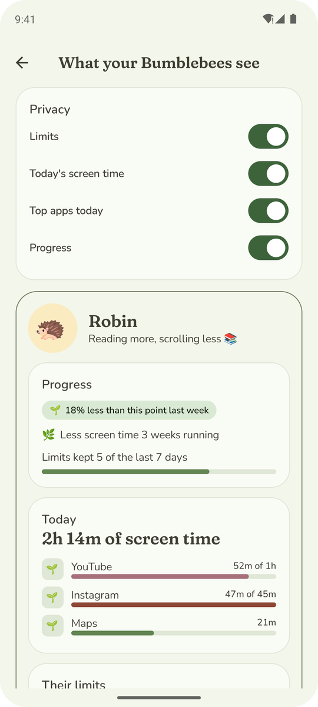

## Make it yours

Choose from six themes, by day or by night. Pick a critter, a flower or a photo for your
picture.

  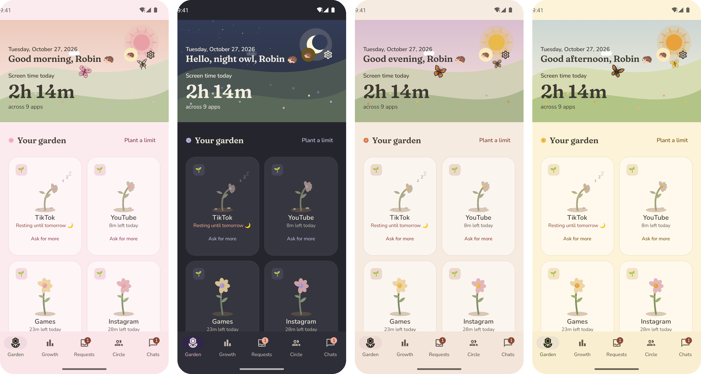

  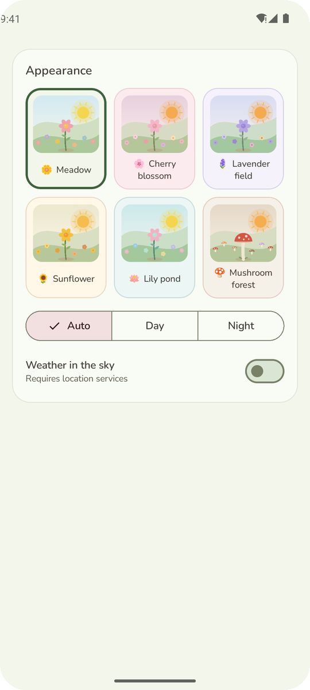
  &nbsp;
  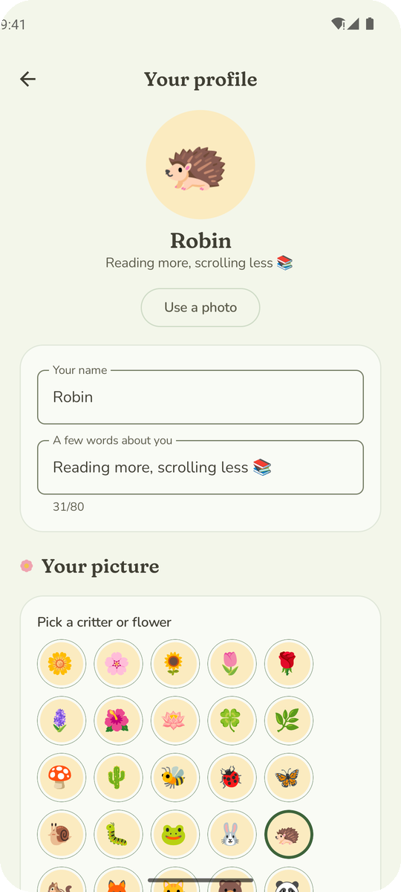
  &nbsp;
  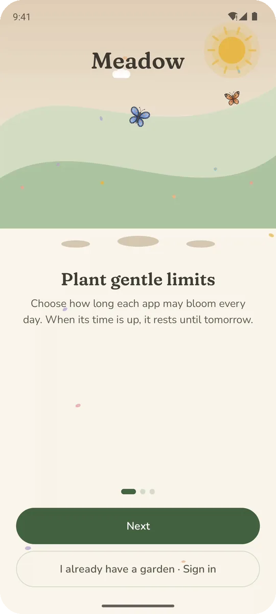

## Get Meadow

Download the latest APK from [Releases](https://github.com/PCOffline/meadow/releases). Open it
on your phone.

To run your own copy of Meadow, read [Running your own Meadow](docs/self-hosting.md).

## Contributing

Issues and pull requests are welcome. Read [CONTRIBUTING.md](CONTRIBUTING.md).

## Licence and credits

Meadow is free software under the [GNU GPL v3](LICENSE). Read the
[terms of use](legal/terms_of_use.md) and the [open-source licences](legal/licenses.md). Fonts:
[Fraunces](https://github.com/undercasetype/Fraunces) and
[Nunito](https://github.com/googlefonts/nunito) (SIL Open Font License).
